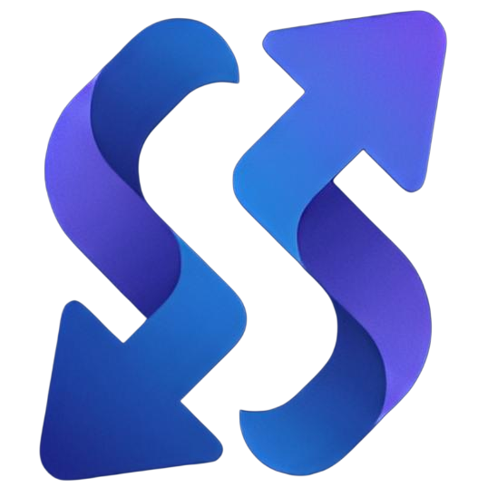
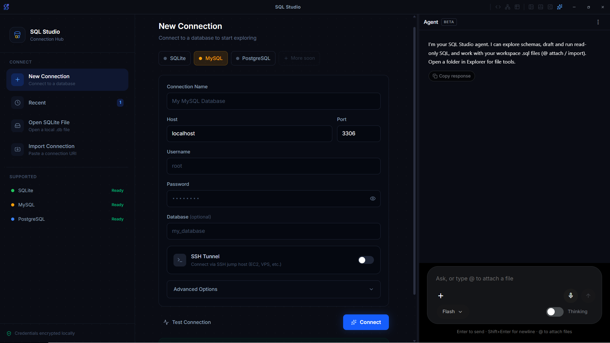
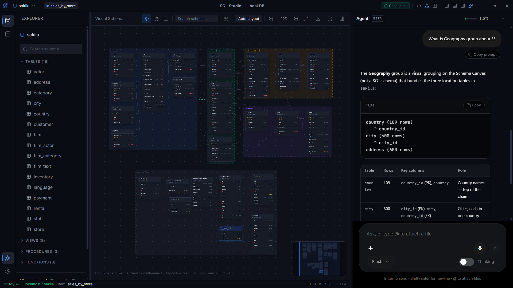
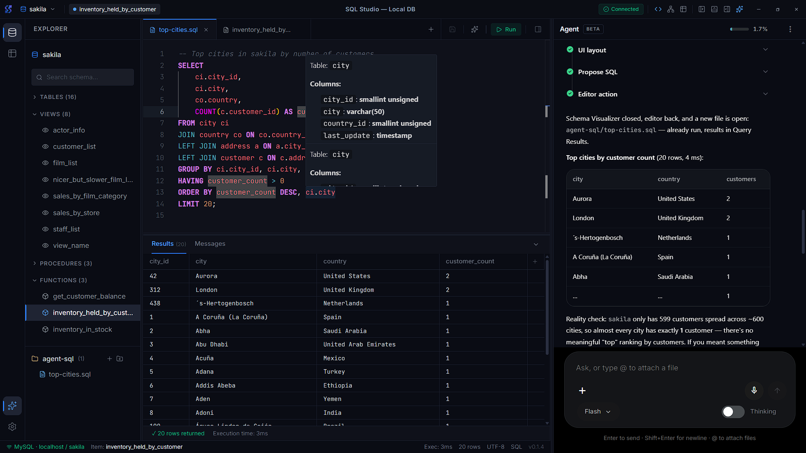
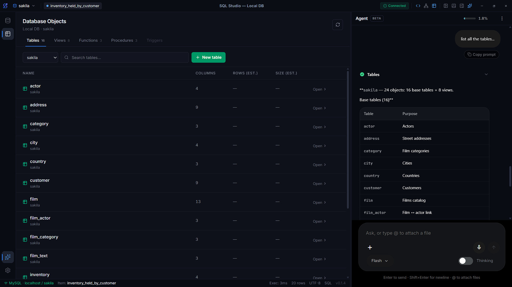
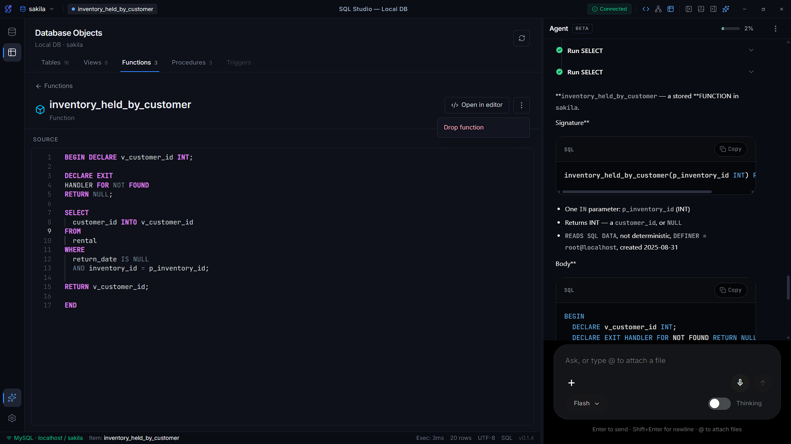
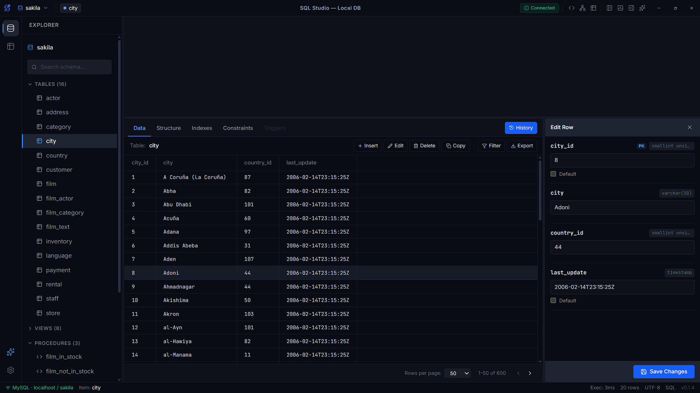

# SQL Studio

### SQL Studio

**v0.1.4** · Local-first desktop SQL IDE · Windows and macOS

A high-performance database client, query IDE, schema visualizer, and optional DeepSeek agent — built with **Tauri 2**, **Rust**, and **React 19**.

[Windows](https://github.com/techxcelerate/sql-studio/releases/download/v0.1.4/SQL.Studio_0.1.4_x64_en-US.msi) · [macOS](https://github.com/techxcelerate/sql-studio/releases/download/v0.1.4/SQL.Studio_0.1.4_aarch64.dmg) · [v0.1.4](https://github.com/techxcelerate/sql-studio/releases/tag/v0.1.4) · [ntxm.org](https://ntxm.org) · [nitiksh](https://nitiksh.ntxm.org)

`PostgreSQL` · `MySQL` · `SQLite`

---

> [!IMPORTANT]
> **SQL Studio is private / proprietary software — it is not open source.**  
> You may use the **official application free of charge** (personal or commercial).  
> You may redistribute **only the official installer**, unmodified, with **SQL Studio / ntxm** names and branding intact.  
> **Nothing else is allowed** — no source, forks, rebrands, or unofficial builds.  
> Full terms: [LICENSE](./LICENSE).

---

## Screenshots (v0.1.4)

  
   
  <em>Connection Hub — MySQL, PostgreSQL, or SQLite, with SSH tunnel and encrypted credentials</em>

  
   
  <em>Schema visualizer — groups, relationships, and the agent explaining a group</em>

  
   
  <em>Monaco editor with schema completions, query results, and the agent</em>

  
   
  <em>Database Objects — every table, with Open, and the agent listing them</em>

  
   
  <em>Functions and procedures — formatted source, Open in editor</em>

  
   
  <em>Data grid — pick another row and the edit panel stays open on that row</em>

---

## What is SQL Studio?

**SQL Studio** is a native desktop database IDE from **[ntxm](https://ntxm.org)** / **[nitiksh](https://nitiksh.ntxm.org)**. Connect to your databases, write SQL in Monaco, browse and edit rows, manage views, functions, and procedures, explore relationships on a live schema canvas, and optionally use a DeepSeek agent — without sending your data to a cloud IDE.

| Pillar | What you get |
|---|---|
| **Local-first** | Connections, credentials, workspace layout, and history stay on your machine |
| **Native speed** | Tauri + Rust drivers — not a heavyweight web shell |
| **Full IDE surface** | Hub → Explorer · editor · Database Objects · data grid · schema canvas · Agent |
| **Secure by default** | Encrypted credentials, SSH tunnels, scoped filesystem access |
| **Private by design** | No product telemetry. Optional AI uses *your* DeepSeek key only when enabled |

---

## Features

### Connection Hub

- **PostgreSQL**, **MySQL** (MariaDB-compatible), and **SQLite** in one place
- Test connection with server version and latency before saving
- Recent connections from the encrypted store
- Quick **Open SQLite file** (WAL and foreign keys on connect)
- **Import** `postgres://` / `mysql://` / SQLite path or URI into the form
- Optional **SSH tunnel** (password or private key) with known-hosts on first connect
- SSL modes: `disable` · `prefer` · `require`

### Workspace and Explorer

- Layout, tabs, and canvas state remembered **per connection and database**
- Schema browser: **Tables · Views · Procedures · Functions**
- Open a workspace folder; create, rename, delete, and open SQL files
- Virtual tabs for scratch queries and object SQL
- Autosave and recovery for unsaved work

### Database Objects

- **Tables · Views · Functions · Procedures** (Triggers are not in this version)
- Table list with column counts and **Open**
- View and routine source, formatted, with **Open in editor**
- Drop a view, function, or procedure where the engine supports it
- Selection stays in sync with the Explorer sidebar

### Monaco SQL editor

- Highlighting, multi-cursor, format, and run
- Schema-aware completions from live introspection
- Several SQL files open, with results under the editor
- **Keep / Revert** when the agent proposes a file or object-SQL edit
- Ask Agent from an editor problem marker

### Schema visualizer

- Pan, zoom, multi-select, hide, and fit
- Auto-layout that respects relationships and **table groups**
- Color-coded groups, links between groups, and a context menu
- Export the diagram as **PNG** or **SVG**, including a whole group or the selected tables even when they are off screen
- Inspector for columns, indexes, constraints, and approximate DDL
- The agent can move the camera, search the canvas, and export a fitted diagram

### Data browser

- Virtualized grid with pagination and row selection
- Visual **filters**
- **Insert / Edit / Delete** using primary-key aware SQL
- Choosing another row while Edit or Delete is open updates that panel instead of closing it
- **Export** the page, the filtered set, or a custom limit as **CSV** or **JSON**
- Structure, indexes, and foreign keys on the same table panel

### DeepSeek agent (optional)

- One chat for the whole app. Switching database or table does not clear it
- Stays on the side of the hub and the workspace
- Works with schema, SQL, explorer, canvas, objects, and the data grid
- Permission modes: **Readonly** · **Ask** · **Allowlist**
- Ask confirms writes. Allowlist runs them. `CREATE DATABASE` and `USE` stay blocked
- Can save and test connections, switch database, and speak a prompt from the microphone
- Long chats send only the recent conversation. The agent can look up an older reply when it needs it
- A failure is shown once, as normal text
- Your DeepSeek key stays encrypted on this PC. Agent traffic goes to DeepSeek only when you use it — not to ntxm

### Desktop chrome

- Custom titlebar and resizable panels
- Activity rail: **Explorer · Database Objects · Agent · Settings**
- Status bar shows the connection, timing, and **v0.1.4**

---

## Security and privacy

| Layer | Detail |
|---|---|
| **Credentials** | AES-256-GCM at rest; random IV per record; key file on this PC |
| **SSH** | Jump host; password or key; first-connect known-hosts |
| **TLS to the database** | `ssl_mode` passed to the driver (`disable` / `prefer` / `require`) |
| **Filesystem** | App data by default; a workspace folder is granted after you open it |
| **Agent SQL** | Read-only checks in Readonly mode, plus database-scope rules |
| **Telemetry** | None from the product |

---

## Download and install

**v0.1.4** is the current release for Windows (x64) and macOS (Apple silicon).

- **[Windows installer (MSI)](https://github.com/techxcelerate/sql-studio/releases/download/v0.1.4/SQL.Studio_0.1.4_x64_en-US.msi)**
- **[macOS installer (Apple silicon DMG)](https://github.com/techxcelerate/sql-studio/releases/download/v0.1.4/SQL.Studio_0.1.4_aarch64.dmg)**
- **[v0.1.4 release page](https://github.com/techxcelerate/sql-studio/releases/tag/v0.1.4)**

1. Download the installer for your computer
2. Install the official build
3. Launch **SQL Studio** and connect from the Hub

| | |
|---|---|
| **Product** | SQL Studio |
| **Version** | **0.1.4** |
| **This release** | Windows x64 · macOS Apple silicon |
| **Engines** | PostgreSQL · MySQL · SQLite |
| **Stack** | Tauri 2 · Rust · React 19 · Monaco |

Only **official** installers published by the copyright holder may be redistributed — unmodified, with the product name and branding intact. Nothing else may be redistributed.

---

## What’s in / out of v0.1.4

**Shipped**

- Multi-engine hub, SSH, and encrypted saved connections
- Monaco editor, schema completions, and Ask Agent from markers
- Database Objects for tables, views, functions, and procedures, with formatted SQL and Open in editor
- Schema canvas with groups, relationships, and PNG/SVG export that can fit a group or a selection
- Data grid with filter, insert, edit, delete, and CSV/JSON export. The edit panel follows the row you click
- One agent chat for the app, with Readonly / Ask / Allowlist, microphone input, and a shorter recent context
- The agent can drive the canvas, connections, and the open workspace
- Workspace persistence

**Not in this version**

- Linux builds of 0.1.4
- Intel Mac builds (the DMG is Apple silicon)
- Triggers
- Extra database engines
- Deploying edited object SQL back to the database from Keep
- SQL dump / INSERT export (CSV and JSON only)
- Schema PDF export
- AI providers other than DeepSeek

---

## License

**SQL Studio Proprietary License** (private) — see [LICENSE](./LICENSE)

Copyright © 2024–2026 **ntxm** / **nitiksh**. All rights reserved.

| You may | You may not (in any case, without prior written permission) |
|---|---|
| Use the official app free (personal or commercial) | Copy, publish, or redistribute the **source** |
| Redistribute the **official installer only**, unmodified, with **SQL Studio / ntxm** branding intact | Modify, rebrand, or ship unofficial packages |
| | Fork or create derivatives from the source |
| | Reverse-engineer binaries beyond what the law requires |
| | Remove copyright / attribution or sell unofficial builds |

**Nothing else is licensed.** Provided **“AS IS”**, without warranty. Written exceptions only: [ntxm.org](https://ntxm.org).

> [!WARNING]
> A public GitHub page does **not** make this open source. Terms in [LICENSE](./LICENSE) control.

---

## Credits

| | |
|---|---|
| **Product** | SQL Studio |
| **Studio** | [ntxm](https://ntxm.org) |
| **Author** | [nitiksh](https://nitiksh.ntxm.org) |
| **v0.1.4** | [Release](https://github.com/techxcelerate/sql-studio/releases/tag/v0.1.4) · [Windows MSI](https://github.com/techxcelerate/sql-studio/releases/download/v0.1.4/SQL.Studio_0.1.4_x64_en-US.msi) · [macOS DMG](https://github.com/techxcelerate/sql-studio/releases/download/v0.1.4/SQL.Studio_0.1.4_aarch64.dmg) |

---

**SQL Studio** · v0.1.4 · Proprietary · Local-first · Windows and macOS

[Windows](https://github.com/techxcelerate/sql-studio/releases/download/v0.1.4/SQL.Studio_0.1.4_x64_en-US.msi) · [macOS](https://github.com/techxcelerate/sql-studio/releases/download/v0.1.4/SQL.Studio_0.1.4_aarch64.dmg) · [v0.1.4](https://github.com/techxcelerate/sql-studio/releases/tag/v0.1.4) · [License](./LICENSE) · [ntxm.org](https://ntxm.org)

